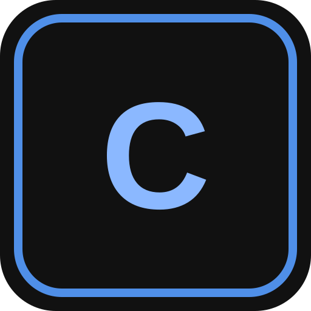
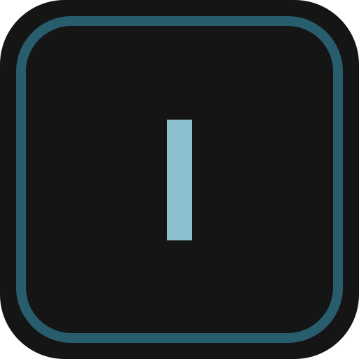

# Louhos

[English](README.md) · **Suomi**

Selainpohjaisia työkaluja live-tuotantoon: cuelistat, kameranvaihtojen seuranta ja videoiden valmistelu areenanäytöille.

[Avaa Louhos →](https://rasse2009.fi/louhos/) · [Ilmoita virheestä](https://github.com/Rassetin/louhos-public/issues/new?template=bug_report.yml) · [Ehdota ominaisuutta](https://github.com/Rassetin/louhos-public/issues/new?template=feature_request.yml)

Tämä on Louhoksen julkinen esittely- ja palauterepo, ei sovellusten lähdekoodi. Se ei sisällä palvelinasetuksia tai käyttäjätietoja.

## Seuraavaksi julkaistaan: Louhos Arena

Rajaa ja jaa video areenan näytöille ja tarkista lopputulos 3D-visualisaattorissa. Arena on kehityksessä ja Louhoksen seuraava suunniteltu julkaisu. Tarkkaa julkaisupäivää ei ole vahvistettu.

- Näyttöjen asettelu ja omat näyttöprofiilit.
- Alkuperäisen videon rajaus, kuvasuhdepresetit ja vientikoon valinta.
- Paikallinen videovienti: tiedostomuoto, koodekki ja kuvataajuus. Koodekkituki riippuu selaimesta.
- Kaarevat näyttönauhat ja erilliset näytöt, myös omilla videoillaan.
- Oman areenan rakentaminen, näyttöjen XYZ-ohjaimet ja WASD-liikkuminen.
- Koko näytön visualisaattori joko säätimillä tai ilman.

Alkuperäiset videot pysyvät omalla koneella, eikä niitä lähetetä Louhoksen palvelimelle. Lista kuvaa kehitysversiota; Arenaa ei ole vielä julkaistu.

[Tutustu Arenaan →](https://rasse2009.fi/louhos/arena/)

## Käytettävissä olevat työkalut

| Työkalu | Käyttö | Linkit |
| --- | --- | --- |
|  **Cue** | Cuelistojen rakentaminen ja ajo. Tuonti taulukosta sekä MIDI-, OSC- ja HTTP-toiminnot. | [Avaa](https://rasse2009.fi/louhos/cue/) · [Ohjeet](https://rasse2009.fi/louhos/cue/documentation/) |
|  **Interval** | vMixin Program- ja Preview-inputit, kamera-ajat sekä tuettujen videoinputtien loppumislaskuri. | [Avaa](https://rasse2009.fi/louhos/interval/) · [Ohjeet](https://rasse2009.fi/louhos/interval/documentation/) |
| **Connect** | Bitfocus Companion -ohjaus Louhos-työkaluille. Valitse oman Companion-versiosi paketti. | [Lataukset ja käyttöönotto](https://rasse2009.fi/louhos/companion/) |
| **Tools** | Pieniä selainpohjaisia työkaluja. | [Avaa](https://rasse2009.fi/louhos/tools/) |

Käyttö riippuu Louhos-tilin oikeuksista. Laitteiden yhteydet voivat vaatia erillisen käyttöönoton; tarkista työkalukohtaiset ohjeet. Kaikkia näkymiä ja ohjeita ei ole vielä englanniksi.

## Myöhemmin

Myös Stage, Equipment, Plan, Comms ja Prompter ovat kehityksessä. Niitä ei ole tässä merkitty julkaistuiksi työkaluiksi. Ominaisuudet ja julkaisujärjestys voivat muuttua; Arena on seuraavana.

## Palaute ja tietoturva

Käytä [Issues-osiota](https://github.com/Rassetin/louhos-public/issues) virheisiin ja ehdotuksiin. Kerro työkalu, selain, toistovaiheet ja odotettu lopputulos. Poista tuotannon tiedot liitteistä.

Älä julkaise salasanoja, istuntotunnisteita, yksityisiä jakolinkkejä tai asiakkaiden tiedostoja. Ilmoita tietoturva-asioista yksityisesti [Louhoksen yhteydenottolomakkeella](https://rasse2009.fi/louhos/#tilityypit); katso [SECURITY.md](SECURITY.md).

## Tilit

Louhos Basic on maksuton. Louhos Pro on valmisteilla. Ajantasaiset tilitiedot ovat [sivustolla](https://rasse2009.fi/louhos/#tilityypit).

Ylläpito: [Rassetin](https://github.com/Rassetin). Päivitetty **25.10.2026**.
